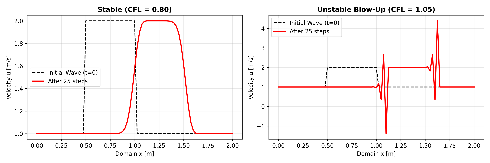

# 2D Incompressible Navier-Stokes Solver in Python

A ground-up finite-difference Computational Fluid Dynamics (CFD) solver written in Python, progressing from 1D hyperbolic/parabolic PDEs to the full 2D incompressible Navier-Stokes equations (Lid-Driven Cavity and Channel Flow).

---

### Repository Roadmap & Progress
- [x] **Step 01:** `01_1D_Linear_Convection_CFL.ipynb` — Upwind finite-difference discretization and Courant–Friedrichs–Lewy (CFL) numerical stability analysis.
- [ ] **Step 02:** `02_1D_Nonlinear_Burgers_Equation.ipynb` — Nonlinear advection, shock wave formation, and viscous diffusion.
- [ ] **Step 03:** `03_2D_Laplace_Poisson_Pressure.ipynb` — Iterative elliptic solvers for the Pressure Poisson Equation.
- [ ] **Step 04:** `04_2D_Lid_Driven_Cavity_NS.ipynb` — Full 2D Navier-Stokes solver validated against **Ghia et al. (1982)** benchmark velocity profiles ($Re = 100, 400$).

---

### Key Result 1: CFL Numerical Stability (`CFL = 0.80` vs. `CFL = 1.05`)
Explicit time-marching schemes require $\text{CFL} = \frac{c\,\Delta t}{\Delta x} \leq 1$ so the numerical domain of dependence encloses the physical domain of dependence. Exceeding unity triggers unbounded oscillatory blow-up:

